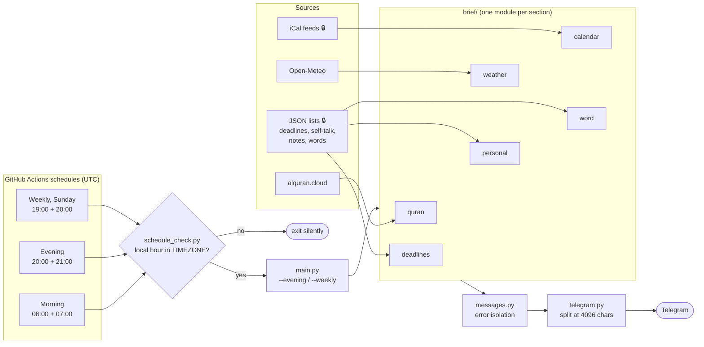

# morning-brief

[](https://github.com/MohamedOuijjane/morning-brief/actions/workflows/ci.yml)

A personal Telegram assistant that runs entirely on GitHub Actions, with no
server and no database. Every day it sends a **morning brief** at 07:00 and an
**evening message** at 21:00, plus a **weekly summary** on Sunday at 20:00, at
local time in your timezone, with automatic handling of clock changes.

Personal content (calendar, deadlines, notes) lives only in encrypted GitHub
secrets. The public code runs on fake data and is fully tested with mocked
network calls.

## Sample messages

All samples below are built from the fake data in this repository.

<details open>
<summary><b>Morning brief</b> · <code>python main.py</code></summary>

```
🌅 Bonjour ! lundi 16 novembre 2026

📖 آية اليوم
﴿ ثُمَّ إِنَّكُمْ يَوْمَ ٱلْقِيَٰمَةِ عِندَ رَبِّكُمْ تَخْتَصِمُونَ ﴾
سُورَةُ الزُّمَرِ — الآية 31
التفسير: إنك -أيها الرسول- ميت وإنهم ميتون، ثم إنكم جميعًا- أيها الناس- يوم القيامة عند ربكم تتنازعون، فيحكم بينكم بالعدل والإنصاف.

💬 كلمة لنفسك اليوم
« كن لطيفًا مع نفسك »
الأخطاء جزء طبيعي من التعلّم. تحدّث مع نفسك كما تتحدث مع صديق عزيز يمرّ بيوم صعب.
🎯 تحدّي اليوم: اكتب شيئًا واحدًا أحسنت فيه بالأمس.

🌧 Météo à Paris
Pluie faible
Actuellement : 10,9 °C
Min / Max : 10,7 °C / 12,9 °C
Risque de pluie : 100 %
Vent : jusqu'à 19,2 km/h

📆 Agenda du jour
Toute la journée  Journée portes ouvertes
Toute la journée  Salon de l'étudiant
En cours  Garde de nuit
09:00  Cours de maths
14:00  Réunion projet
18:30  Sport

📅 Échéances (14 prochains jours)
🔴 Submit sample project report : mar. 17 nov. (demain)
🟡 Pay example utility bill : ven. 20 nov. (dans 4 jours)
🟢 Renew placeholder library card : jeu. 26 nov. (dans 10 jours)

💬 Mot du jour
🇸🇦 حديقة — نجلس في الحديقة بعد الظهر.
🇫🇷 jardin — Nous nous asseyons dans le jardin l'après-midi.
🇬🇧 garden — We sit in the garden in the afternoon.
```
</details>

<details>
<summary><b>Evening message</b> · <code>python main.py --evening</code></summary>

```
🌙 Bonsoir lundi 16 novembre 2026

🎯 تحدّي اليوم: اكتب شيئًا واحدًا أحسنت فيه بالأمس.
هل فعلته؟

📖 آية المساء
﴿ وَلَا تَهِنُوا۟ وَلَا تَحْزَنُوا۟ وَأَنتُمُ ٱلْأَعْلَوْنَ إِن كُنتُم مُّؤْمِنِينَ ﴾
سُورَةُ آلِ عِمۡرَانَ — الآية 139
التفسير: ولا تضْعُفوا -أيها المؤمنون- عن قتال عدوكم، ولا تحزنوا لما أصابكم في "أُحد"، وأنتم الغالبون والعاقبة لكم، إن كنتم مصدقين بالله ورسوله متَّبعين شرعه.

📆 Demain
Toute la journée  Salon de l'étudiant
07:00  Natation
10:00  Demain pas aujourd'hui
18:30  Sport

⏰ À rendre demain
• Submit sample project report

🌃 قبل النوم: تذكّر شيئًا جميلًا حدث اليوم مهما كان صغيرًا.
```
</details>

<details>
<summary><b>Weekly summary</b> · <code>python main.py --weekly</code></summary>

```
🗓 Semaine du lundi 23 novembre au dimanche 29 novembre

📆 Lundi 23
09:00  Cours de maths
18:30  Sport

📆 Mardi 24
07:00  Natation
18:30  Sport

📆 Mercredi 25
18:30  Sport

📆 Jeudi 26
18:30  Sport

📆 Vendredi 27
18:30  Sport

📆 Samedi 28
18:30  Sport

📆 Dimanche 29
18:30  Sport

⏰ Échéances de la semaine
• jeu. 26 nov. : Renew placeholder library card

9 événements, 1 échéance.
```
</details>

## Architecture



- **Two UTC hours per message.** GitHub cron runs in UTC only. Each message
  is scheduled at the two UTC hours that can match the local target hour, and
  `schedule_check.py` keeps the one that matches `TIMEZONE`. This handles
  clock changes with no manual edits.
- **Independent sections.** Every section is fetched on its own, with retries.
  If one fails, the message is still sent with a short "indisponible" line in
  its place.
- **Reliability.** A failed run sends a short Telegram alert. A keepalive job
  stops GitHub from disabling the schedule after 60 days without activity.

## Setup

1. **Create a bot**: message **@BotFather** on Telegram, send `/newbot`, and
   keep the token.
2. **Get your chat ID**: send any message to your bot, then open
   `https://api.telegram.org/bot<TOKEN>/getUpdates` and copy `chat.id`.
3. **Fork this repository** and add the secrets in
   **Settings → Secrets and variables → Actions**:

   ```bash
   gh secret set TELEGRAM_TOKEN
   gh secret set TELEGRAM_CHAT_ID
   gh secret set TIMEZONE                       # e.g. Europe/Paris
   gh secret set DEADLINES_JSON < deadlines.json    # optional
   gh secret set GCAL_ICS_URLS  < gcal_urls.txt     # optional, one URL per line
   ```

4. **Test it** from the Actions tab (**Morning brief → Run workflow**, choose a
   mode), or with `gh workflow run morning.yml -f mode=evening`.
5. **Adjust the cron hours** in `.github/workflows/morning.yml` if your
   timezone is not UTC+0/UTC+1.

### Run locally

```bash
python -m venv .venv && source .venv/bin/activate
pip install -r requirements.txt
cp .env.example .env          # then fill in your values
python main.py --dry-run      # also --evening / --weekly
pip install pytest ruff && ruff check . && pytest
```

## Configuration

Secrets hold anything personal. Other settings can be secrets or repository
variables, or `.env` entries for local runs.

| Name | Default | Description |
| --- | --- | --- |
| `TELEGRAM_TOKEN`, `TELEGRAM_CHAT_ID` | – | Bot token and destination chat (required) |
| `TIMEZONE` | `Europe/Paris` | Local timezone for dates and send hours |
| `LATITUDE`, `LONGITUDE`, `CITY_NAME` | Paris | Weather location |
| `GCAL_ICS_URLS` | – | Secret iCal URLs, one per line (`GCAL_ICS_URL` for a single one) |
| `DEADLINES_JSON` | example file | Deadlines: `[{"title": "...", "date": "YYYY-MM-DD"}]` |
| `SELF_TALK_JSON` | example file | Self-talk: `[{"title", "body", "challenge"}]` |
| `NIGHT_NOTES_JSON` | example file | Bedtime notes: list of strings |
| `WORDS_JSON` | example file | Words: `[{"ar", "fr", "en", "ar_example", ...}]` |
| `DEADLINES_DAYS` | `14` | Look-ahead window for the morning deadlines |
| `ENABLE_QURAN`, `ENABLE_SELF_TALK`, `ENABLE_WORD` | `true` | Morning sections |
| `ENABLE_EVENING`, `ENABLE_EVENING_VERSE`, `ENABLE_NIGHT_NOTE` | `true` | Evening message and sections |
| `ENABLE_WEEKLY` | `true` | Weekly summary |
| `MORNING_HOUR`, `EVENING_HOUR`, `WEEKLY_HOUR` | `7`, `21`, `20` | Local send hours (repository variables) |

## Privacy by design

The code is public, but the data is not.

- **Personal data lives only in secrets.** Calendars, deadlines, self-talk,
  notes and the word list come from encrypted GitHub secrets. Locally they come
  from git-ignored files (`*.json`, `gcal_urls.txt`). The repository only
  contains `*.example.json` files with placeholder content.
- **Nothing private reaches the logs.** Actions logs are public on a public
  repository. Errors are logged as `section failed: ErrorType`, never with
  URLs, titles or message text. Dry runs in CI replace private sections with
  `[hidden in CI logs]`.
- **The failure alert is generic.** It contains a fixed text and a link to
  the run, and the Telegram API response is discarded.
- **Tests never touch real data.** The suite blocks the network, ignores any
  local `.env`, and reads only fixtures and example files.
- **CI needs no secrets.** Lint and tests run on push and pull request
  without access to any credential.

## License

[MIT](LICENSE)
